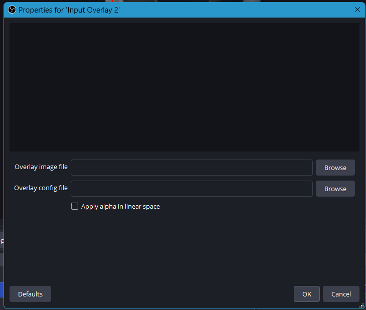
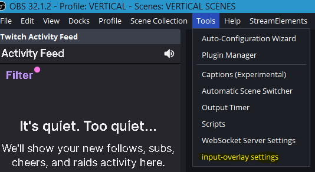

# 🎮 Custom Game Controller Overlays

https://github.com/user-attachments/assets/8f4a8c69-a899-4374-bb58-5563f0f86e51 https://github.com/user-attachments/assets/dd66200b-0de9-469b-94e9-5c6e85b18a77

Custom game controller overlays for streaming software, including **OBS Studio**, **Meld Studio**, and **Streamlabs**.

These overlays use the [Input Overlay](https://github.com/univrsal/input-overlay) plugin to display controller inputs on stream. This repository contains custom overlay designs and their configuration files.

## 📥 Installation Instructions

### Step 1 — Download the Files

1. Download this repository as a ZIP file.
2. Extract the ZIP file to a location of your choice.

### Step 2 — Install the Input Overlay Plugin

1. Open **Folder `A`**.
2. Run the included `.exe` installer.
3. Follow the installation prompts to install the Input Overlay plugin.

> **Note:** Input Overlay is a third-party OBS plugin. See the [official Input Overlay repository](https://github.com/univrsal/input-overlay) for its documentation and licensing information.

### Step 3 — Install the Custom Controller Overlay

1. Open **Folder `B`**.
2. Copy the folder named `Controller Overlay NIXSTAH`.
3. Paste it into the location where you keep your custom OBS overlay assets.

**Important:** Keep the `.png` and `.json` files together in the same folder. The plugin needs both files to load the overlay correctly.

### Step 4 — Add the Overlay to OBS

1. Open OBS Studio.
2. Navigate to the scene where you want the controller overlay to appear.
3. In the **Sources** panel, click **`+`**.
4. Select **Input Overlay**.
5. In the source properties window:
   - Click **Browse** for the image field and select the overlay's `.png` file.
   - Click **Browse** for the configuration field and select the matching `.json` file from the same folder.
6. Apply the settings and position the overlay where you want it on your scene.

## ⚙️ Additional Settings

Input Overlay includes an additional settings menu inside OBS Studio.

To access it, open the **Tools** menu at the top of OBS and select the Input Overlay settings option.

## ✅ You're All Set!

Your custom controller overlay should now be visible in your OBS scene. Move, resize, and position it to suit your stream layout.

If the overlay does not appear correctly, double-check that you selected the correct `.png` and `.json` files and that both files remain in the same folder.

---

## 📜 Credits & Third-Party Software

### Input Overlay

This project uses **Input Overlay**, an OBS Studio plugin created by **[UNIVRSAL](https://github.com/univrsal)**.

Input Overlay provides the underlying functionality for displaying keyboard, mouse, and gamepad inputs in streaming software. The custom overlay designs and related configuration files in this repository are my own contributions, unless otherwise indicated.

- **Original project:** [univrsal/input-overlay](https://github.com/univrsal/input-overlay)
- **Original author:** [UNIVRSAL](https://github.com/univrsal)
- **Original license:** [GNU General Public License v2.0 (GPL-2.0)](https://github.com/univrsal/input-overlay/blob/master/LICENSE)

All credit for the original Input Overlay plugin belongs to its original author. This repository is an independent project and is not affiliated with, endorsed by, or officially associated with UNIVRSAL or the Input Overlay project.

The original plugin remains subject to its own copyright notices and license terms. Please refer to the [official repository](https://github.com/univrsal/input-overlay) for its source code, releases, documentation, and complete licensing information.

